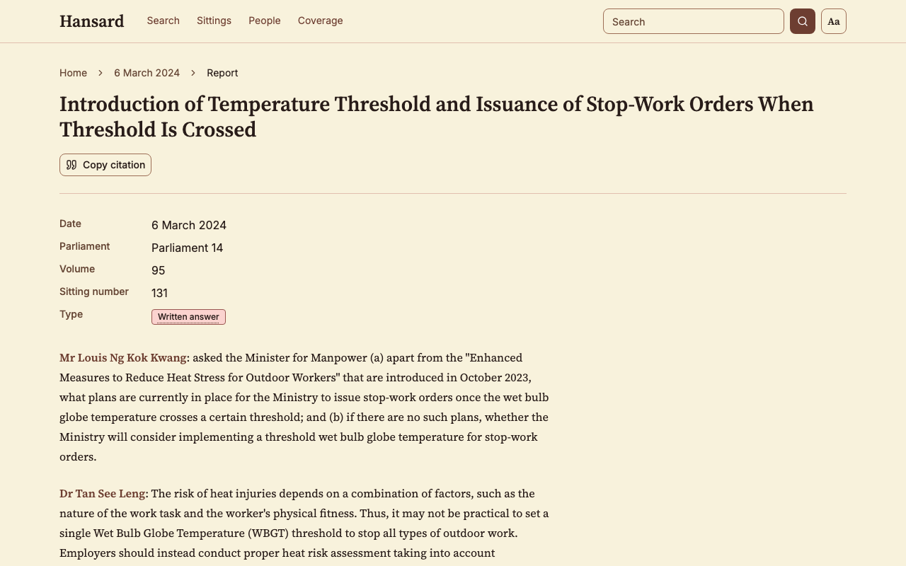

<picture>
  <source media="(prefers-color-scheme: dark)" srcset="docs/images/banner-dark.svg">
  
</picture>

The website at [hansard.fancybinary.sg](https://hansard.fancybinary.sg) takes each report from Singapore's Official Report and shows it as speeches. It links each speech to the person who gave it, when the speaker label is enough to tell who spoke.

[Open the site](https://hansard.fancybinary.sg) · [Coverage](https://hansard.fancybinary.sg/coverage) · [Data quality and methods](https://hansard.fancybinary.sg/coverage/methods)

- The site is live and has been public since 20 October 2026.
- It is not an official Parliament site. The Official Report on [SPRS](https://sprs.parl.gov.sg/search/) is the authoritative record, and each report page links to its copy there.
- The data comes from [roycehoe/hansard-scraper](https://github.com/roycehoe/hansard-scraper). This site only reads it.

## Try it

- [Find your MP](https://hansard.fancybinary.sg/people?constituency=Ang%20Mo%20Kio&parliament=15). Pick a constituency on /people to list who sat for it in the latest Parliament.
- [A sitting](https://hansard.fancybinary.sg/sittings/2024-03-06) lists its reports, then who was present and who was absent.
- [A report](https://hansard.fancybinary.sg/reports/written-answer-16079) shows the text as speeches. Each speech has Copy link, Cite and Report an error beside it, and the Source line links to the report on SPRS.
- [A speech link](https://hansard.fancybinary.sg/reports/written-answer-16079?s=1&q=asked+the+minister+for+manpower+a+apart+from) opens one speech.
- [A person's page](https://hansard.fancybinary.sg/people/399-louis-ng-kok-kwang) lists their memberships, their paragraphs and attendance in each Parliament, and every report they spoke in.
- [Search](https://hansard.fancybinary.sg/search?q=heat%20stress) covers speeches and report titles, with filters for Parliament, dates, report type, person and constituency.

<picture>
  <source media="(prefers-color-scheme: dark)" srcset="docs/images/report-dark.png">
  
</picture>

## Report an error

Email royceinbox@hotmail.com, or use the "Report an error" link beside any speech, which opens an email with that speech's link filled in. To report in public, use the [Report an error form](https://github.com/roycehoe/hansard/issues/new?template=report-an-error.yml).

## How it was built

[docs/how-this-was-built.md](docs/how-this-was-built.md) describes how the code was written and the audits that checked it.

## Run it locally

To run it you need Node 24 with pnpm, Python 3.15 with uv, and a copy of the scraper's database. The [hansard-scraper README](https://github.com/roycehoe/hansard-scraper#setup) explains how to build one.

```bash
# API, from api/
uv sync
DATABASE_URL=postgresql://... uv run fastapi dev   # http://localhost:8000

# Frontend, from app/
pnpm install
pnpm dev                                           # http://localhost:5173
```

The deployed site is one container that serves the frontend at `/` and the API at `/api`. When the app and API checks pass on `master`, CI deploys it to DigitalOcean App Platform, which builds the [Dockerfile](Dockerfile) as [.do/app.yaml](.do/app.yaml) specifies.

```bash
docker build -t hansard-web .
docker run -p 8080:8080 -e DATABASE_URL=... -e BASIC_AUTH_USERNAME=... -e BASIC_AUTH_PASSWORD=... hansard-web
```

Conventions for each part are in [app/CLAUDE.md](app/CLAUDE.md) and [api/CLAUDE.md](api/CLAUDE.md).

## Licence

The code is under the [MIT licence](LICENSE).
